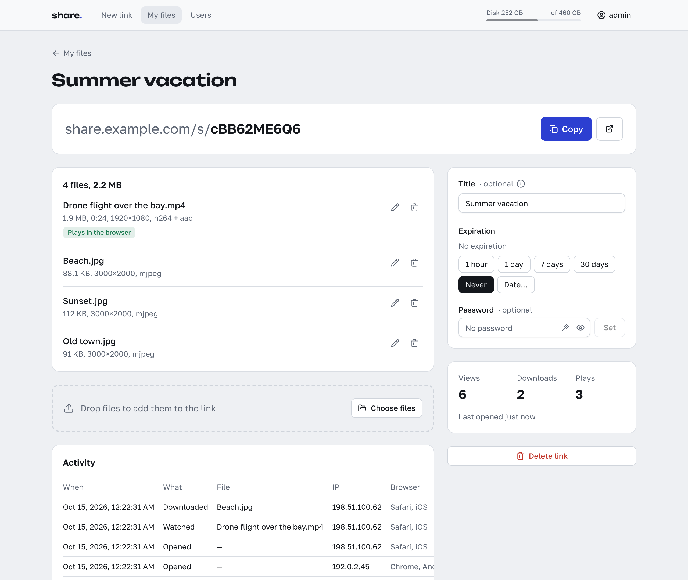
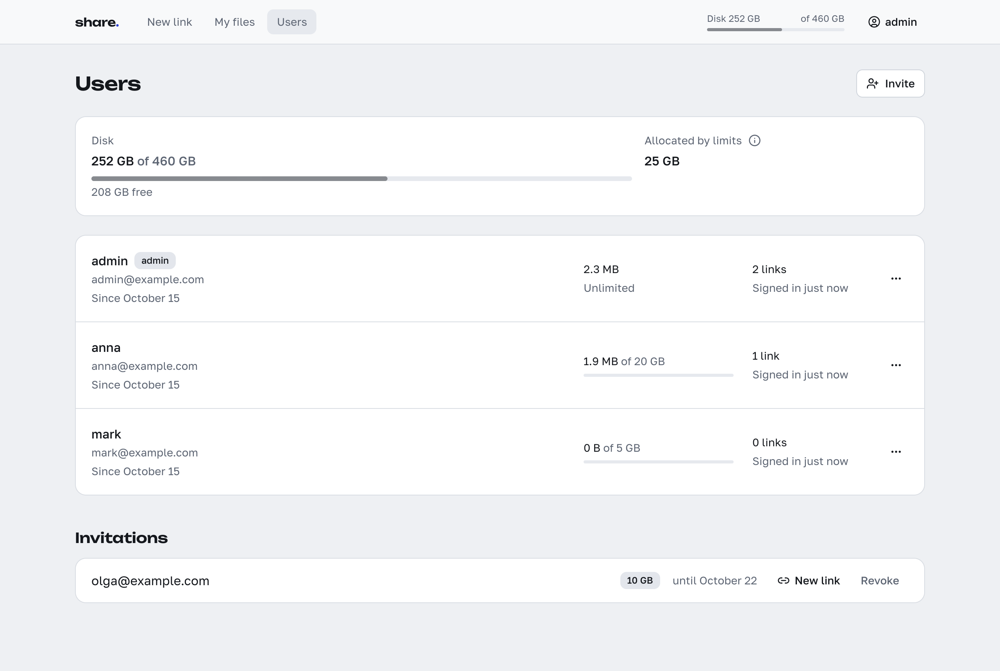

# share

[Русская версия](README.ru.md)

[](https://github.com/nikitakiselev/share-selfhosted/actions/workflows/ci.yml)

share is a self-hosted file sharing service: you upload files and send a link, the recipient
watches the video in the browser or downloads the files.


## Why

Messengers recompress video and limit file size. Cloud drives make the recipient sign in or
install an app. share serves the file as it was uploaded, through a link that opens in a browser
without an account.

## Features

- **Video in original quality in the browser.** Video is never re-encoded. H.264, VP8, VP9 and AV1
  in MP4, MOV or WebM play as uploaded. Other containers (MKV, AVI, TS and so on) are repackaged
  into MP4 with the video stream copied; audio other than AAC, MP3, Opus or FLAC is converted to
  AAC. The repackaged copy keeps only the first video and audio track; the original stays
  available for download. HEVC and 10-bit H.264 play only in browsers that can decode them; other
  video codecs are download-only. Audio in AAC, MP3, Opus, Vorbis, FLAC or PCM plays on the page,
  images open in a viewer. Files are processed with ffmpeg in the background after upload, one at
  a time.
- **Link previews in messengers.** The link page carries Open Graph tags: title, file type or
  number of files, size, and a picture made from the first video or image. A password-protected
  link shows neither file names nor a picture.
- **Resumable uploads.** Files are uploaded over [tus](https://tus.io) in 64 MiB chunks, two files
  at a time. When the connection drops, the upload pauses and continues from where the server left
  off. After a page reload unfinished uploads stay in the list: in Chromium-based browsers they
  continue after one click, in others after you pick the same files again (matched by name, size
  and modification time).
- **Password and expiry.** Both are set per link and can be changed at any time; after a password
  change visitors have to enter the new one. Expiry: 1 hour, 1 day, 7 days, 30 days, never, or a
  chosen date. An expired link stops opening; for 7 more days the owner can extend it, then the
  link is deleted together with its files.
- **ZIP.** All files of a link in one archive, built on the fly without compression. Its size is
  known up front, so the browser shows download progress.
- **Statistics.** For each link: opens, downloads (ZIP included), video plays, and an activity log
  of the last 200 events with time, file, IP address and browser. The owner's own visits and
  link-preview bots are not counted; repeated opens from one IP within 30 minutes count once.
- **Users by invitation, with storage limits.** See
  [Users and administration](#users-and-administration).
- **User management only from the internal network.** It is available to the admin only from
  addresses in `SHARE_INTERNAL_NETS`. Uploads and your own links work from anywhere.



## Quick start

```sh
mkdir share && cd share
curl -fsSLO https://raw.githubusercontent.com/nikitakiselev/share-selfhosted/main/docker-compose.yml
curl -fsSL -o .env https://raw.githubusercontent.com/nikitakiselev/share-selfhosted/main/.env.example
```

Fill in the required variables in `.env`:

- `SHARE_PUBLIC_URL` — the address users open, for example `https://share.example.com`;
- `SHARE_SECRET` — the output of `openssl rand -hex 32`;
- `SHARE_ADMIN_EMAIL` and `SHARE_ADMIN_PASSWORD` — the first admin, for example
  `admin@example.com` and a password of at least 10 characters.

Start the container and check the log:

```sh
docker compose up -d
docker compose logs share
```

The log should contain `created the first admin`. Open `SHARE_PUBLIC_URL` and sign in with
`SHARE_ADMIN_EMAIL` and the password.

After the first start remove the `SHARE_ADMIN_PASSWORD` line from `.env` and run
`docker compose up -d` again. The first admin is created only while the database has no users;
after that the password lives in the database (it is changed in the interface or with
[`set-password`](#command-line)), the variable is ignored, and every start logs
`SHARE_ADMIN_PASSWORD is ignored`.

The container listens on port 8000. With an `https` address in `SHARE_PUBLIC_URL` cookies get the
`Secure` flag, and the browser does not accept them over plain HTTP: signing in at
`http://server:8000` will not work. Put a [reverse proxy](#reverse-proxy) with HTTPS in front.

## Configuration

All settings are environment variables, `.env` in the example above.

| Variable | Default | Description |
|---|---|---|
| `SHARE_PUBLIC_URL` | — | **Required.** The address users open, `http(s)://host`. Links, invites, password reset links and link previews are built from it. |
| `SHARE_SECRET` | — | **Required.** At least 16 characters, `openssl rand -hex 32`. Signs the cookies that unlock password-protected links. |
| `SHARE_ADMIN_EMAIL` | — | **Required on the first start**, while there are no users: the first admin's email. |
| `SHARE_ADMIN_PASSWORD` | — | **Required on the first start**: the first admin's password, 10 to 200 characters. Ignored afterwards. |
| `SHARE_DEFAULT_QUOTA_GB` | `1` | Storage limit of new invitations unless the admin sets another: a whole number of GiB (1 or more) or `unlimited`. |
| `SHARE_LANGUAGE` | `en` | Language of link previews and of the pages the server renders: `en` or `ru`. The interface follows the browser language: Russian for `ru*`, English otherwise. |
| `SHARE_TRUSTED_PROXIES` | `10.0.0.0/8,172.16.0.0/12,192.168.0.0/16,fc00::/7,127.0.0.0/8,::1/128` | Addresses or networks of reverse proxies, comma-separated. `X-Forwarded-For` is accepted only from them; an empty value means it is not accepted at all. See [below](#why-share_trusted_proxies). |
| `SHARE_INTERNAL_NETS` | `10.0.0.0/8,172.16.0.0/12,192.168.0.0/16,fc00::/7` | Networks from which the admin can manage users. Loopback (`127.0.0.0/8`, `::1/128`) is always added. |
| `SHARE_COOKIE_SECURE` | on if `SHARE_PUBLIC_URL` is `https` | `Secure` flag on cookies. `0`, `false`, `no`, `off` turn it off, any other value turns it on. |
| `SHARE_DATA_DIR` | `/data` | Database and files. |
| `SHARE_STATIC_DIR` | `/app/static` | Built frontend. |
| `SHARE_HOST` | `0.0.0.0` | Listen address. |
| `SHARE_PORT` | `8000` | Listen port. |
| `SHARE_FFMPEG` | `ffmpeg` | Path to ffmpeg. |
| `SHARE_FFPROBE` | `ffprobe` | Path to ffprobe. |

The last six describe the inside of the image and normally do not need changing.

## Reverse proxy

The Caddy and nginx examples assume the proxy runs on the same host and the port is published as
`127.0.0.1:8000:8000` (see the [tip below](#why-share_trusted_proxies)).

### Caddy

```caddy
share.example.com {
	reverse_proxy 127.0.0.1:8000
}
```

Nothing else is needed: by default Caddy sets `X-Forwarded-For` and does not limit the total time
of reading the request body or writing the response.

### nginx

```nginx
server {
    listen 443 ssl;
    server_name share.example.com;

    ssl_certificate     /etc/ssl/share.example.com/fullchain.pem;
    ssl_certificate_key /etc/ssl/share.example.com/privkey.pem;

    client_max_body_size 0;
    proxy_request_buffering off;
    proxy_buffering off;

    location / {
        proxy_pass http://127.0.0.1:8000;
        proxy_set_header Host $host;
        proxy_set_header X-Forwarded-For $proxy_add_x_forwarded_for;
    }
}
```

- `client_max_body_size 0` — uploads arrive in 64 MiB chunks, and nginx accepts only 1 MB by
  default.
- `proxy_request_buffering off` — without it nginx reads each whole chunk before passing it on.
- `proxy_buffering off` — files and video go to the client directly. With buffering on, nginx
  writes the part of a response that does not fit its memory buffers to a temporary file, up to
  1 GB per response by default.
- share reads `X-Forwarded-For` for the client address. `Host` is compared with `Origin` when a
  request comes to an address other than `SHARE_PUBLIC_URL`. `X-Forwarded-Proto` is not read: the
  scheme comes from `SHARE_PUBLIC_URL`.
- The default timeouts (60 s) count the time between two successive reads or writes, not the
  whole request, so they do not cut long uploads and downloads.

### Traefik

```yaml
services:
  share:
    image: ghcr.io/nikitakiselev/share-selfhosted:latest
    restart: unless-stopped
    env_file: .env
    volumes:
      - data:/data
    networks:
      - traefik
    labels:
      - traefik.enable=true
      - traefik.http.routers.share.rule=Host(`share.example.com`)
      - traefik.http.routers.share.entrypoints=websecure
      - traefik.http.routers.share.tls.certresolver=letsencrypt
      - traefik.http.services.share.loadbalancer.server.port=8000

volumes:
  data:

networks:
  traefik:
    external: true
```

`websecure`, `letsencrypt` and the `traefik` network are names from your Traefik setup. `ports` is
not needed: Traefik reaches the container over the Docker network.

In Traefik v3 the entry point option `transport.respondingTimeouts.readTimeout` defaults to `60s`
and limits reading the entire request, body included. Every 64 MiB chunk is a separate request, so
with the default the sender needs about 9 Mbit/s of upload speed; on a slower connection the
requests are cut off. Raise the limit in the static configuration of the entry point:

```yaml
entryPoints:
  websecure:
    address: ":443"
    transport:
      respondingTimeouts:
        readTimeout: 600s
```

The same as a flag: `--entryPoints.websecure.transport.respondingTimeouts.readTimeout=600s`.
600 s fits a chunk at about 1 Mbit/s; `0` turns the timeout off. Downloads are not limited:
`writeTimeout` defaults to `0`.

### Why `SHARE_TRUSTED_PROXIES`

- `X-Forwarded-For` is accepted only when the connection comes from an address in this list; from
  anyone else the header is ignored.
- The client is the rightmost address in the chain that is not in the list. If every address is
  in the list, the client is the leftmost one.
- The default is private networks plus loopback. A proxy on the same host reaches the container
  from the Docker gateway address (`172.17.0.1` and the like), a proxy in the local network from
  a private address; both work without configuration.
- If the proxy connects from a public address (a CDN, a separate VPS), list its addresses
  explicitly. Otherwise share sees every visitor with the proxy's address.
- The client address decides access to user management (`SHARE_INTERNAL_NETS`), the limits on
  password attempts, and what statistics and the activity log record.

If the proxy runs on the same host, publish the port on loopback only:

```yaml
    ports:
      - "127.0.0.1:8000:8000"
```

Otherwise the port is reachable directly, bypassing the proxy, and connections through Docker's
userland proxy (for example over IPv6) arrive from the Docker gateway address, that is from a
private network.

## Users and administration



The admin is the account created on the first start; invited users are regular users and manage
only their own links. User management is on the "Users" page.

- **Invitations.** An invitation is issued for an email address. share sends no email: the admin
  copies the invitation link and passes it on. The link works once, for 7 days; "New link"
  replaces a lost one, and a new invitation to the same address replaces the unused earlier one.
- **Sign-up and sign-in.** By the link the person chooses a username (3 to 32 characters: Latin
  letters, digits, dot, hyphen, underscore) and a password (at least 10 characters). They sign in
  with the email; the username is only displayed.
- **Limits.** Every user has a permanent storage limit. An invitation gets `SHARE_DEFAULT_QUOTA_GB`
  unless the admin sets another value; the admin can change the limit of any user, their own
  included. The first admin has no limit. A limit below the space already used deletes nothing,
  but new files cannot be uploaded. Limits are not reserved and their
  total may exceed the disk; an upload is refused if the disk has no room for it plus 1 GiB.
- **Other actions.** A one-time password reset link (valid for 24 hours), blocking (sign-in is
  closed and the user's links stop opening, files are kept), deletion together with links and
  files. The admin cannot be blocked or deleted.
- **Internal networks only.** The user management API answers only to the admin and only from
  addresses in `SHARE_INTERNAL_NETS`. A stolen admin session used from the internet does not give
  control over users.

### Command line

```sh
# set a password: one line from stdin, at least 10 characters; all of the user's sessions are revoked
printf %s 'new-password' | docker compose exec -T share share-app set-password --email admin@example.com

# change an email; an address that belongs to another user is refused
docker compose exec share share-app set-email --email admin@example.com --new-email owner@example.com
```

Both commands work for any user.

## Backups and updates

The `/data` volume contains:

- `share.db` — SQLite database (WAL mode: `share.db-wal` and `share.db-shm` sit next to it while
  share is running);
- `files/` — the uploaded files;
- `derived/` — MP4 copies repackaged for the browser and preview frames;
- `uploads/` — unfinished uploads.

A consistent backup with the container stopped:

```sh
docker compose stop
docker compose run --rm --user root -v "$PWD":/backup share tar cf /backup/share-data.tar -C /data .
docker compose start
```

Without stopping: the image has no `sqlite3` command, so the database is copied with Python's
SQLite backup API, then the directories:

```sh
mkdir -p backup
docker compose exec -T share python -c "import sqlite3; s = sqlite3.connect('/data/share.db'); d = sqlite3.connect('/tmp/share.db'); s.backup(d); d.close()"
docker compose cp share:/tmp/share.db backup/share.db
for d in files derived uploads; do docker compose cp share:/data/$d backup/; done
```

The database goes first: files that appear after its copy are deleted on the first start after a
restore as unknown to the database.

Update:

```sh
docker compose pull
docker compose up -d
```

Images are published for amd64 and arm64 with the tags `latest` (the latest stable release),
`X.Y.Z` and `X.Y`.

## Development

Backend (`backend/`, Starlette + SQLite + ffmpeg):

```sh
cd backend
uv venv -p 3.12 && uv pip install -e '.[dev]'
uv run pytest              # media tests need ffmpeg and ffprobe in PATH
uvx ruff check src tests
```

Running the backend locally is described in [backend/README.md](backend/README.md).

Frontend (`frontend/`, Vue 3):

```sh
cd frontend
npm ci
npm run dev        # Vite; /api and /healthz are proxied to the backend at 127.0.0.1:8000
npx vitest run
npm run build      # into frontend/dist, which the backend serves from SHARE_STATIC_DIR
```

## macOS app

`macos/` holds a small menu bar app: drop files on it and copy the link. It signs in through
the website (the `/connect` page) and uploads over the same tus API. Building needs Xcode, see
[macos/README.md](macos/README.md).

## License

MIT, see [LICENSE](LICENSE).
