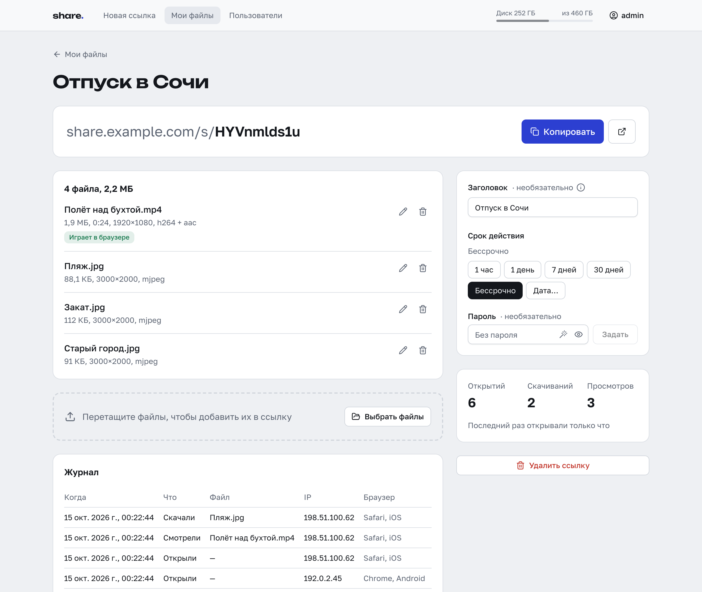
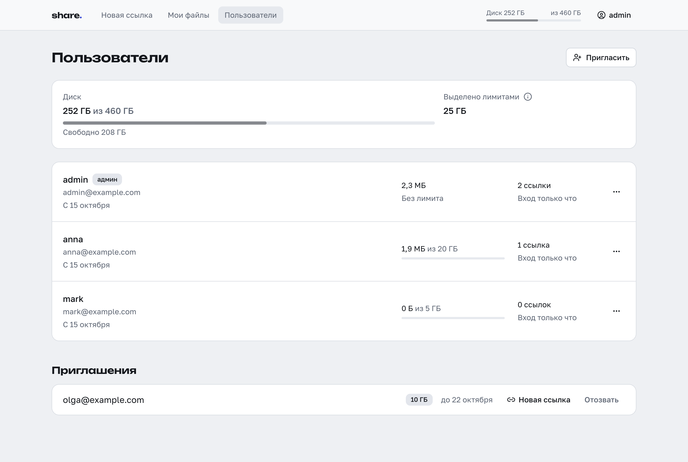

# share

[English version](README.md)

[](https://github.com/nikitakiselev/share-selfhosted/actions/workflows/ci.yml)

share — самохостинговый файлообменник: вы загружаете файлы и отправляете ссылку, получатель
смотрит видео в браузере или скачивает файлы.


## Зачем

Мессенджеры пережимают видео и ограничивают размер файла, а бывают и недоступны или медленны.
Облака заставляют получателя входить в аккаунт или ставить приложение. share отдаёт файл таким,
каким его загрузили, по ссылке, которая открывается в браузере без регистрации.

## Возможности

- **Видео в исходном качестве в браузере.** Видео никогда не перекодируется. H.264, VP8, VP9 и AV1
  в MP4, MOV или WebM играют как загружены. Другие контейнеры (MKV, AVI, TS и т. п.)
  перепаковываются в MP4 с копированием видеопотока; звук, кроме AAC, MP3, Opus и FLAC,
  перекодируется в AAC. В перепакованной копии остаются только первая видео- и первая аудиодорожка,
  оригинал доступен для скачивания. HEVC и 10-битный H.264 играют только в браузерах, которые
  умеют их декодировать; видео в остальных кодеках доступно только для скачивания. Аудио в AAC,
  MP3, Opus, Vorbis, FLAC или PCM играет на странице, изображения открываются в просмотрщике.
  Обработка идёт через ffmpeg в фоне после загрузки, по одному файлу.
- **Превью ссылок в мессенджерах.** На странице ссылки есть теги Open Graph: название, тип или
  число файлов, размер и картинка из первого видео или изображения. Ссылка под паролем не
  показывает ни имён файлов, ни картинки.
- **Докачка.** Файлы загружаются по [tus](https://tus.io) частями по 64 МиБ, по два файла
  одновременно. При обрыве связи загрузка встаёт на паузу и продолжается с того места, где
  остановился сервер. После перезагрузки страницы незавершённые загрузки остаются в списке: в
  браузерах на Chromium они продолжаются одним кликом, в остальных — после повторного выбора тех же
  файлов (они узнаются по имени, размеру и времени изменения).
- **Пароль и срок.** Задаются для каждой ссылки и меняются в любой момент; после смены пароля
  посетителям нужно ввести новый. Срок: 1 час, 1 день, 7 дней, 30 дней, без срока или конкретная
  дата. Истёкшая ссылка перестаёт открываться; ещё 7 дней владелец может её продлить, затем ссылка
  удаляется вместе с файлами.
- **ZIP.** Все файлы ссылки одним архивом, который собирается на лету без сжатия. Размер известен
  заранее, поэтому браузер показывает прогресс скачивания.
- **Статистика.** Для каждой ссылки: открытия, скачивания (включая ZIP), просмотры видео и журнал
  последних 200 событий со временем, файлом, IP-адресом и браузером. Визиты владельца и боты,
  строящие превью, не считаются; повторные открытия с одного IP в течение 30 минут считаются
  одним.
- **Пользователи по приглашению, с лимитами места.** См.
  [Пользователи и администрирование](#пользователи-и-администрирование).
- **Управление пользователями только из внутренней сети.** Оно доступно администратору только с
  адресов из `SHARE_INTERNAL_NETS`. Загрузка и свои ссылки работают откуда угодно.



## Быстрый старт

```sh
mkdir share && cd share
curl -fsSLO https://raw.githubusercontent.com/nikitakiselev/share-selfhosted/main/docker-compose.yml
curl -fsSL -o .env https://raw.githubusercontent.com/nikitakiselev/share-selfhosted/main/.env.example
```

Заполните в `.env` обязательные переменные:

- `SHARE_PUBLIC_URL` — адрес, который открывают пользователи, например `https://share.example.com`;
- `SHARE_SECRET` — вывод `openssl rand -hex 32`;
- `SHARE_ADMIN_EMAIL` и `SHARE_ADMIN_PASSWORD` — первый администратор, например
  `admin@example.com` и пароль не короче 10 символов.

Запустите контейнер и проверьте журнал:

```sh
docker compose up -d
docker compose logs share
```

В журнале должна быть строка `created the first admin`. Откройте `SHARE_PUBLIC_URL` и войдите с
`SHARE_ADMIN_EMAIL` и паролем.

После первого запуска удалите строку `SHARE_ADMIN_PASSWORD` из `.env` и снова выполните
`docker compose up -d`. Первый администратор создаётся, только пока в базе нет пользователей;
дальше пароль живёт в базе (меняется в интерфейсе или командой
[`set-password`](#командная-строка)), переменная игнорируется, и при каждом запуске в журнале
появляется `SHARE_ADMIN_PASSWORD is ignored`.

Контейнер слушает порт 8000. Если в `SHARE_PUBLIC_URL` адрес с `https`, cookie получают флаг
`Secure`, и браузер не принимает их по обычному HTTP: войти через `http://сервер:8000` не
получится. Поставьте перед share [reverse proxy](#reverse-proxy) с HTTPS.

## Настройки

Все настройки — переменные окружения, в примере выше это `.env`.

| Переменная | По умолчанию | Описание |
|---|---|---|
| `SHARE_PUBLIC_URL` | — | **Обязательная.** Адрес, который открывают пользователи, `http(s)://host`. Из него строятся ссылки, приглашения, ссылки сброса пароля и превью. |
| `SHARE_SECRET` | — | **Обязательная.** Не короче 16 символов, `openssl rand -hex 32`. Подписывает cookie, открывающие ссылки под паролем. |
| `SHARE_ADMIN_EMAIL` | — | **Обязательна при первом запуске**, пока нет пользователей: email первого администратора. |
| `SHARE_ADMIN_PASSWORD` | — | **Обязательна при первом запуске**: пароль первого администратора, от 10 до 200 символов. Потом игнорируется. |
| `SHARE_DEFAULT_QUOTA_GB` | `1` | Лимит места в новых приглашениях, если администратор не задал другой: целое число ГиБ (от 1) или `unlimited`. |
| `SHARE_LANGUAGE` | `en` | Язык превью ссылок и страниц, которые отдаёт сервер: `en` или `ru`. Язык интерфейса берётся из браузера: русский для `ru*`, иначе английский. |
| `SHARE_TRUSTED_PROXIES` | `10.0.0.0/8,172.16.0.0/12,192.168.0.0/16,fc00::/7,127.0.0.0/8,::1/128` | Адреса или сети reverse proxy через запятую. `X-Forwarded-For` принимается только от них; пустое значение — не принимается совсем. См. [ниже](#зачем-share_trusted_proxies). |
| `SHARE_INTERNAL_NETS` | `10.0.0.0/8,172.16.0.0/12,192.168.0.0/16,fc00::/7` | Сети, из которых администратор может управлять пользователями. Loopback (`127.0.0.0/8`, `::1/128`) добавляется всегда. |
| `SHARE_COOKIE_SECURE` | включён, если `SHARE_PUBLIC_URL` на `https` | Флаг `Secure` у cookie. `0`, `false`, `no`, `off` выключают, любое другое значение включает. |
| `SHARE_DATA_DIR` | `/data` | База и файлы. |
| `SHARE_STATIC_DIR` | `/app/static` | Собранный фронтенд. |
| `SHARE_HOST` | `0.0.0.0` | Адрес, который слушает сервер. |
| `SHARE_PORT` | `8000` | Порт, который слушает сервер. |
| `SHARE_FFMPEG` | `ffmpeg` | Путь к ffmpeg. |
| `SHARE_FFPROBE` | `ffprobe` | Путь к ffprobe. |

Последние шесть описывают устройство образа, внутри него их обычно менять не нужно.

## Reverse proxy

Примеры для Caddy и nginx предполагают, что прокси работает на том же хосте, а порт опубликован
как `127.0.0.1:8000:8000` (см. [совет ниже](#зачем-share_trusted_proxies)).

### Caddy

```caddy
share.example.com {
	reverse_proxy 127.0.0.1:8000
}
```

Больше ничего не нужно: по умолчанию Caddy передаёт `X-Forwarded-For` и не ограничивает общее
время чтения тела запроса и записи ответа.

### nginx

```nginx
server {
    listen 443 ssl;
    server_name share.example.com;

    ssl_certificate     /etc/ssl/share.example.com/fullchain.pem;
    ssl_certificate_key /etc/ssl/share.example.com/privkey.pem;

    client_max_body_size 0;
    proxy_request_buffering off;
    proxy_buffering off;

    location / {
        proxy_pass http://127.0.0.1:8000;
        proxy_set_header Host $host;
        proxy_set_header X-Forwarded-For $proxy_add_x_forwarded_for;
    }
}
```

- `client_max_body_size 0` — загрузка приходит частями по 64 МиБ, а nginx по умолчанию принимает
  только 1 МБ.
- `proxy_request_buffering off` — без него nginx сначала читает каждую часть целиком и только потом
  передаёт дальше.
- `proxy_buffering off` — файлы и видео идут клиенту напрямую. С буферизацией nginx пишет то, что
  не помещается в буферы в памяти, во временный файл, по умолчанию до 1 ГБ на ответ.
- share читает `X-Forwarded-For` — адрес клиента. `Host` сверяется с `Origin`, когда запрос пришёл
  не на адрес из `SHARE_PUBLIC_URL`. `X-Forwarded-Proto` не читается: схема берётся из
  `SHARE_PUBLIC_URL`.
- Таймауты по умолчанию (60 с) отсчитываются между двумя операциями чтения или записи, а не на весь
  запрос, поэтому долгие загрузки и скачивания они не обрывают.

### Traefik

```yaml
services:
  share:
    image: ghcr.io/nikitakiselev/share-selfhosted:latest
    restart: unless-stopped
    env_file: .env
    volumes:
      - data:/data
    networks:
      - traefik
    labels:
      - traefik.enable=true
      - traefik.http.routers.share.rule=Host(`share.example.com`)
      - traefik.http.routers.share.entrypoints=websecure
      - traefik.http.routers.share.tls.certresolver=letsencrypt
      - traefik.http.services.share.loadbalancer.server.port=8000

volumes:
  data:

networks:
  traefik:
    external: true
```

`websecure`, `letsencrypt` и сеть `traefik` — имена из вашей настройки Traefik. `ports` не нужен:
Traefik ходит в контейнер по сети Docker.

В Traefik v3 у точки входа параметр `transport.respondingTimeouts.readTimeout` по умолчанию равен
`60s` и ограничивает чтение всего запроса вместе с телом. Каждая часть в 64 МиБ — отдельный запрос,
поэтому с умолчанием отправителю нужно около 9 Мбит/с исходящей скорости; на более медленном
соединении запросы обрываются. Поднимите лимит в статической конфигурации точки входа:

```yaml
entryPoints:
  websecure:
    address: ":443"
    transport:
      respondingTimeouts:
        readTimeout: 600s
```

То же флагом: `--entryPoints.websecure.transport.respondingTimeouts.readTimeout=600s`.
600 с хватает на часть при скорости около 1 Мбит/с; `0` выключает таймаут. Скачивание не
ограничено: `writeTimeout` по умолчанию равен `0`.

### Зачем `SHARE_TRUSTED_PROXIES`

- `X-Forwarded-For` принимается, только если соединение пришло с адреса из этого списка; от всех
  остальных заголовок игнорируется.
- Клиентом считается крайний справа адрес цепочки, не входящий в список. Если в списке все адреса,
  клиент — самый левый.
- По умолчанию в списке частные сети и loopback. Прокси на том же хосте виден из контейнера с
  адреса шлюза Docker (`172.17.0.1` и т. п.), прокси в локальной сети — с частного адреса; оба
  случая работают без настройки.
- Если прокси подключается с публичного адреса (CDN, отдельный VPS), задайте его адреса явно.
  Иначе share увидит всех посетителей с адресом прокси.
- От адреса клиента зависят доступ к управлению пользователями (`SHARE_INTERNAL_NETS`),
  ограничение попыток ввода пароля, а также то, что попадает в статистику и журнал.

Если прокси на том же хосте, публикуйте порт только на loopback:

```yaml
    ports:
      - "127.0.0.1:8000:8000"
```

Иначе к порту можно обратиться напрямую в обход прокси, а соединение через userland-proxy Docker
(например, по IPv6) приходит с адреса шлюза Docker, то есть из частной сети.

## Пользователи и администрирование



Администратор — учётная запись, созданная при первом запуске; приглашённые пользователи обычные и
управляют только своими ссылками. Управление пользователями — на странице «Пользователи».

- **Приглашения.** Приглашение выдаётся на email. Писем share не отправляет: администратор
  копирует ссылку приглашения и передаёт её сам. Ссылка срабатывает один раз в течение 7 дней;
  «Новая ссылка» заменяет потерянную, а новое приглашение на тот же адрес заменяет
  неиспользованное прежнее.
- **Регистрация и вход.** По ссылке человек выбирает имя пользователя (от 3 до 32 символов:
  латиница, цифры, точка, дефис, подчёркивание) и пароль (не короче 10 символов). Входит он по
  email, имя пользователя только отображается.
- **Лимиты.** У каждого пользователя постоянный лимит места. Приглашение получает
  `SHARE_DEFAULT_QUOTA_GB`, если администратор не задал другое значение; администратор может
  изменить лимит любого пользователя, в том числе свой. У первого администратора лимита нет. Лимит
  ниже уже занятого места ничего не удаляет, но новые файлы загрузить нельзя. Лимиты не
  резервируют место, и их сумма может превышать диск; загрузка отклоняется, если на диске нет места
  под неё плюс 1 ГиБ.
- **Другие действия.** Одноразовая ссылка сброса пароля (действует 24 часа), блокировка (вход
  закрыт, ссылки пользователя перестают открываться, файлы сохраняются), удаление вместе со
  ссылками и файлами. Администратора нельзя заблокировать или удалить.
- **Только из внутренних сетей.** API управления пользователями отвечает только администратору и
  только с адресов из `SHARE_INTERNAL_NETS`. Украденная сессия администратора из интернета не даёт
  управлять пользователями.

### Командная строка

```sh
# задать пароль: одна строка из stdin, не короче 10 символов; все сессии пользователя завершаются
printf %s 'new-password' | docker compose exec -T share share-app set-password --email admin@example.com

# сменить email; адрес, занятый другим пользователем, не принимается
docker compose exec share share-app set-email --email admin@example.com --new-email owner@example.com
```

Обе команды работают для любого пользователя.

## Бэкапы и обновление

В томе `/data` лежат:

- `share.db` — база SQLite (режим WAL: пока share работает, рядом лежат `share.db-wal` и
  `share.db-shm`);
- `files/` — загруженные файлы;
- `derived/` — копии MP4, перепакованные для браузера, и кадры для превью;
- `uploads/` — незавершённые загрузки.

Согласованный бэкап с остановкой контейнера:

```sh
docker compose stop
docker compose run --rm --user root -v "$PWD":/backup share tar cf /backup/share-data.tar -C /data .
docker compose start
```

Без остановки: в образе нет команды `sqlite3`, поэтому база копируется через backup API SQLite из
Python, затем каталоги:

```sh
mkdir -p backup
docker compose exec -T share python -c "import sqlite3; s = sqlite3.connect('/data/share.db'); d = sqlite3.connect('/tmp/share.db'); s.backup(d); d.close()"
docker compose cp share:/tmp/share.db backup/share.db
for d in files derived uploads; do docker compose cp share:/data/$d backup/; done
```

База копируется первой: файлы, появившиеся после её копии, при первом запуске после
восстановления удаляются как неизвестные базе.

Обновление:

```sh
docker compose pull
docker compose up -d
```

Образы публикуются для amd64 и arm64 с тегами `latest` (последний стабильный релиз), `X.Y.Z` и
`X.Y`.

## Разработка

Бэкенд (`backend/`, Starlette + SQLite + ffmpeg):

```sh
cd backend
uv venv -p 3.12 && uv pip install -e '.[dev]'
uv run pytest              # тестам медиа нужны ffmpeg и ffprobe в PATH
uvx ruff check src tests
```

Локальный запуск бэкенда описан в [backend/README.md](backend/README.md).

Фронтенд (`frontend/`, Vue 3):

```sh
cd frontend
npm ci
npm run dev        # Vite; /api и /healthz проксируются на бэкенд 127.0.0.1:8000
npx vitest run
npm run build      # в frontend/dist, его бэкенд отдаёт из SHARE_STATIC_DIR
```

## Лицензия

MIT, см. [LICENSE](LICENSE).
